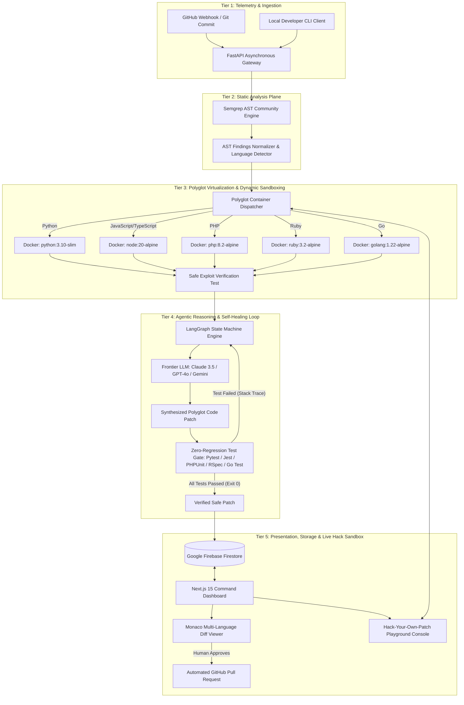

# PATCHGUARD: Master Architectural & Engineering Specification
**Autonomous Closed-Loop Vulnerability Remediation Agent**  
*CSIT321 Capstone Project Sequence (Autumn 2026 & Winter 2027)*  
*School of Computer Science, University of Wollongong in Dubai (UOWD)*  
*Faculty Supervision: Prof. May El Barachi (Dean / Course Coordinator)*  

---

## Document Metadata & Status
- **Project Title:** PatchGuard (formerly conceptualized as VulnSynth-Agent)
- **Document Version:** 2.2.0 (Polyglot Multi-Language Specification with Firebase & Interactive Hack Sandbox)
- **Status:** Officially Approved Capstone Project (October 2026)
- **Target Environments:** CI/CD Pipelines (GitHub Actions / GitLab CI), Local Developer Workstations, Enterprise DevSecOps Centers
- **Supported Polyglot Ecosystems:** Python, JavaScript, TypeScript, PHP, Ruby, Go
- **Reference Benchmarks:** Semgrep Engine, SWE-bench (Princeton), AutoCodeRover (NUS), OWASP Top 10 Multi-Language Benchmarks

---

# 1. Core Concept & Mission

### 1.1 The Industry Problem Statement
In modern software engineering environments, the speed of code delivery—accelerated by AI-assisted "vibe coding"—has created an acute crisis in application security (AppSec):
1. **The 85%+ False Positive Crisis (Alert Fatigue):** Traditional Static Application Security Testing (SAST) tools (such as Snyk, SonarQube, and Veracode) inspect code using rigid pattern heuristics. Across enterprise codebases, over 85% of flagged alerts are unexploitable false alarms. Developers drown in noise and spend countless hours manually triaging harmless warnings.
2. **The 65-Day Vulnerability Exposure Window (Prolonged MTTR):** Because security analysts cannot manually prove which vulnerabilities are exploitable, the industry Mean Time to Remediate (MTTR) stretches to an average of 65 days. Live production systems remain exposed to active cyber exploits for months.
3. **The Developer Fear of Regressions:** Even when a legitimate vulnerability is identified, software engineers hesitate or refuse to touch the code. In complex production systems, manual or AI-generated fixes frequently break business logic, corrupt application state, or cause costly runtime regressions.
4. **The Polyglot Stack Reality:** Modern software systems are rarely mono-repo single-language projects. A single enterprise ecosystem frequently combines Python microservices, Node.js/TypeScript frontend APIs, legacy PHP or Ruby backend services, and high-performance Go micro-daemons. Security tools that only support one language create fragmented, disjointed defense workflows.
5. **The Blind Spots of Existing Automation:**
   - *Dependency Bots (e.g., Dependabot):* Only bump third-party library versions in configuration files; they cannot fix first-party custom business logic or source code vulnerabilities.
   - *General AI Assistants (e.g., GitHub Copilot, ChatGPT):* Operate out-of-band without runtime execution context. They hallucinate invalid syntax, introduce subtle security regressions, and possess zero automated verification mechanisms.

### 1.2 The PatchGuard Mission & Value Proposition
**PatchGuard** is an autonomous, closed-loop DevSecOps remediation agent that bridges the gap between static vulnerability discovery and empirical, regression-free repair across polyglot web ecosystems.

Rather than generating passive alerts or unverified AI suggestions, PatchGuard enforces a deterministic, closed-loop verification pipeline:
1. **Extracts** taint paths from source to execution sinks using syntax-aware static analysis across 6 supported languages via Semgrep.
2. **Proves** exploitability dynamically inside isolated, ephemeral Docker sandboxes—instantly eliminating the 85% false alarm noise.
3. **Synthesizes** minimal code patches using an agentic Large Language Model (LLM) state machine (LangGraph) tailored to the target language syntax and security idioms.
4. **Enforces** a Zero-Regression Test Gate by running the repository's pre-existing automated test suites (Pytest, Jest, Vitest, PHPUnit, RSpec, Go Test) inside language-specific sandboxes, using an iterative self-healing reflection loop to correct errors if any feature breaks.
5. **Enables Interactive Hack Simulation:** Allows developers and evaluators to fire custom exploit payloads live against unpatched vs patched containers in an interactive web playground.
6. **Maintains** Developer-in-the-Loop governance by presenting verified, ready-to-merge GitHub Pull Requests with side-by-side Monaco code diffs and sandbox execution proofs stored in **Google Firebase Firestore**.

### 1.3 Target Software Scope: Polyglot Ecosystem
To demonstrate genuine enterprise capability, PatchGuard supports 6 high-demand web and systems languages:

| Tier | Language | Primary Frameworks | Package / Test Harness | Sample Vulnerability Target |
| :---: | :--- | :--- | :--- | :--- |
| **Tier 1 (Core Benchmark)** | **Python** | FastAPI, Flask, Django | `pip` / `pytest` | SQL Injection, Command Injection, Path Traversal |
| **Tier 1 (Web Standard)** | **JavaScript** | Express.js, Fastify | `npm` / `jest` | SQL Injection (`pg`/`mysql2`), Command Injection |
| **Tier 1 (Enterprise)** | **TypeScript** | NestJS, Express | `npm` / `vitest` | Prototype Pollution, Insecure Direct Object References |
| **Tier 2 (Polyglot Adapter)** | **PHP** | Laravel, Vanilla PHP | `composer` / `phpunit` | SQL Injection (`mysqli`), Remote Code Execution |
| **Tier 2 (Polyglot Adapter)** | **Ruby** | Ruby on Rails, Sinatra | `bundler` / `rspec` | SQL Injection (ActiveRecord bypass), Command Injection |
| **Tier 2 (High-Perf Systems)** | **Go (Golang)** | Gin, Fiber, Chi | `go mod` / `go test` | SQL Injection (`database/sql`), SSRF |

---

# 2. Final Agreed Feature Set

### 2.1 Core MVP Requirements (Trimester 1 & Trimester 2 Base Scope)

| Feature / Subsystem | Architectural Description | Delivery Phase |
| :--- | :--- | :---: |
| **1. AST Static Taint Analysis** | Fast, deterministic scanning using Semgrep Community Edition CLI. Parses code into Abstract Syntax Trees (ASTs) to trace untrusted user input variables from entry sources to dangerous sinks across all 6 supported languages. | Trimester 1 (Engine) |
| **2. Ephemeral Docker Sandbox** | Container lifecycle engine managed via Docker Python SDK (`docker`). Spins up lightweight, isolated container replicas in < 2s to execute safe exploit verification scripts and prevent host system contamination. | Trimester 1 (Engine) |
| **3. Non-Destructive Exploit Prover** | AI-generated benign Proof-of-Concept (PoC) test scripts (e.g., HTTP test payloads, timing probes, SQL boolean checks) to confirm vulnerability reachability before code is touched. | Trimester 1 (Engine) |
| **4. Agentic Patch Synthesizer** | Multi-agent state machine built with **LangGraph** orchestrating LLMs (Claude 3.5 Sonnet / GPT-4o / Gemini Flash) via structured Pydantic schemas to output syntactically valid code diffs in the target language. | Trimester 1 (Engine) |
| **5. Zero-Regression Test Gate** | Automated programmatic runner executing target repository test suites (Pytest, Jest, Vitest, PHPUnit, RSpec, Go Test) inside Docker; detects broken assertions or compilation errors. | Trimester 1 (Engine) |
| **6. Iterative Self-Healing Loop** | Closed-loop reflection mechanism: when a test suite detects a regression, the runtime error traceback is reflected back into LangGraph to iteratively refine the patch (capped at 3 retry attempts). | Trimester 1 (Engine) |
| **7. Standalone CLI Engine** | Unified terminal interface (`python patchguard.py --target ./app`) executing the full closed loop and emitting verified `.patch` diff files. | Trimester 1 (W10 PoC) |
| **8. Interactive Figma PoC Prototype** | High-fidelity, interactive clickable UI prototype demonstrating the developer review journey, vulnerability triage, and Monaco diff review. | Trimester 1 (W9 Deliverable) |
| **9. FastAPI Orchestration Gateway** | Asynchronous REST API managing scan jobs, background task workers, and **Google Firebase Firestore** persistence for vulnerability history and real-time audit trails. | Trimester 1 (Skeleton) / Trimester 2 (Full) |
| **10. Google Firebase Cloud Datastore** | Cloud Firestore NoSQL document database providing native JSON storage of scan contracts and real-time WebSocket sync to the frontend. | Trimester 1 (Setup) / Trimester 2 (Live Sync) |
| **11. Polyglot Container Dispatcher** | Dynamic container routing engine that detects repo language and launches the matching lightweight Docker runtime (`python:3.10-slim`, `node:20-alpine`, `php:8.2-alpine`, `ruby:3.2-alpine`, `golang:1.22-alpine`). | Trimester 2 |
| **12. Next.js Web Command Center** | Responsive web dashboard built with Next.js 15 (App Router) and Tailwind CSS displaying real-time scan telemetry and audit logs. | Trimester 2 |
| **13. Monaco Diff Review Editor** | Embedded VS Code Monaco Editor (`@monaco-editor/react`) rendering side-by-side red/green code diffs with multi-language syntax highlighting for visual inspection. | Trimester 2 |
| **14. 'Hack-Your-Own-Patch' Playground** | Live interactive console in Next.js allowing developers to submit custom attack payloads to Docker, comparing responses on unpatched vs patched code in real time, with an optional AI Red-Team bypass generator. | Trimester 2 |
| **15. Automated GitHub PR Bot** | GitHub App / Webhook integration: upon human approval in the dashboard, PatchGuard branches the repository and opens an automated Pull Request with attached exploit proof and test logs. | Trimester 2 |
| **16. Empirical Benchmark Evaluation** | Rigorous academic evaluation across 30 real-world CVE repositories spanning all 6 supported languages: Python, JavaScript, TypeScript, PHP, Ruby, and Go (derived from OWASP and multi-language CVE benchmarks) evaluating remediation success rate, regression rate, and latency. | Trimester 2 |

---

# 3. Technical Architecture & System Workflows

### 3.1 Five-Tier Decoupled Architecture



### 3.2 The Polyglot Container Dispatcher Matrix

The dispatcher inspects repository file extensions and applies the matching configuration seamlessly:

```python
# Polyglot Dispatcher Configuration in FastAPI Backend
POLYGLOT_REGISTRY = {
    "PYTHON": {
        "extensions": [".py"],
        "docker_image": "python:3.10-slim",
        "test_command": "pytest --json-report",
        "package_manager": "pip install -r requirements.txt",
        "prompt_role": "You are a Senior Python Security Engineer. Output standard, idiomatic Python."
    },
    "JAVASCRIPT": {
        "extensions": [".js", ".jsx", ".mjs"],
        "docker_image": "node:20-alpine",
        "test_command": "npm test -- --json",
        "package_manager": "npm install",
        "prompt_role": "You are a Senior Node.js Security Engineer. Output clean, modern ECMAScript."
    },
    "TYPESCRIPT": {
        "extensions": [".ts", ".tsx"],
        "docker_image": "node:20-alpine",
        "test_command": "npx vitest run --reporter=json",
        "package_manager": "npm install && npx tsc --noEmit",
        "prompt_role": "You are a Senior TypeScript Security Engineer. Enforce strict type safety."
    },
    "PHP": {
        "extensions": [".php"],
        "docker_image": "php:8.2-cli-alpine",
        "test_command": "vendor/bin/phpunit --log-json report.json",
        "package_manager": "composer install",
        "prompt_role": "You are a Senior PHP Security Engineer. Utilize modern PDO prepared statements."
    },
    "RUBY": {
        "extensions": [".rb"],
        "docker_image": "ruby:3.2-alpine",
        "test_command": "bundle exec rspec --format json",
        "package_manager": "bundle install",
        "prompt_role": "You are a Senior Ruby Security Engineer. Adhere to Rails/Sinatra best practices."
    },
    "GO": {
        "extensions": [".go"],
        "docker_image": "golang:1.22-alpine",
        "test_command": "go test -json ./...",
        "package_manager": "go mod download",
        "prompt_role": "You are a Senior Go Security Engineer. Output idiomatic, performant Go code."
    }
}
```

### 3.3 The Standard Data Contract (`vulnerability_contract.json`)
The immutable schema stored in Google Firebase Firestore:

```json
{
  "vulnerability_id": "PG-2026-SQLI-001",
  "target_language": "PYTHON",
  "vulnerability_type": "SQL_INJECTION",
  "target_file": "backend/auth.py",
  "line_number": 42,
  "vulnerable_code": "query = f'SELECT * FROM users WHERE name = \\'{username}\\''",
  "taint_source": "username = request.args.get('username')",
  "taint_sink": "db.execute(query)",
  "is_exploitable": true,
  "exploit_proof_payload": "' OR '1'='1",
  "exploit_telemetry": {
    "http_status_unpatched": 200,
    "http_status_patched": 400,
    "execution_time_ms": 32.5
  },
  "patch_code": "query = 'SELECT * FROM users WHERE name = ?'\\nparams = (username,)",
  "patch_diff": "--- a/backend/auth.py\\n+++ b/backend/auth.py\\n@@ -42,1 +42,2 @@\\n- query = f'SELECT * FROM users WHERE name = \\'{username}\\''\\n+ query = 'SELECT * FROM users WHERE name = ?'\\n+ params = (username,)",
  "test_runner_used": "pytest",
  "pytest_passed": true,
  "hack_playground_history": [
    {
      "custom_payload": "admin' --",
      "result_unpatched": "LEAK_DETECTED (200 OK)",
      "result_patched": "BLOCKED (400 Bad Request)",
      "timestamp": "2026-10-21T18:30:00Z"
    }
  ],
  "created_at": "2026-10-21T18:25:00Z"
}
```

---

# 4. Finalized Tech Stack & Dependencies

| Layer / Role | Selected Technology | Version / Spec | Purpose & Rationale |
| :--- | :--- | :--- | :--- |
| **Core Architecture Language** | Python | 3.10+ | Primary language for backend, AI orchestration, static analysis wrappers, and sandbox controllers. |
| **Frontend Language** | TypeScript | 5.0+ | Enforces strict type safety across the Next.js web dashboard and Monaco Editor bindings. |
| **Static Code Analyzer** | Semgrep Community Edition | Latest CLI | Fast semantic AST parsing and taint tracking across Python, JS, TS, PHP, Ruby, and Go. |
| **AI Orchestration** | LangGraph (Python) | Latest | Stateful multi-agent graph architecture supporting cyclic reflection and self-healing test loops. |
| **Data Validation** | Pydantic | v2.0+ | Enforces strict JSON schema validation on all LLM structured outputs. |
| **Foundation Models** | Claude 3.5 Sonnet / GPT-4o / Gemini Flash | Frontier Cloud APIs | State-of-the-art coding and security reasoning models for polyglot patch synthesis and exploit proofing. |
| **Virtualization Sandbox** | Docker Engine Python SDK | `docker >= 6.0` | Programmatic lifecycle control of ephemeral, isolated polyglot container sandboxes. |
| **Regression Testing Gates** | Pytest, Jest, Vitest, PHPUnit, RSpec, Go Test | Native Frameworks | Deterministic verification harnesses running native test commands inside matching containers. |
| **Backend Framework** | FastAPI | `fastapi >= 0.100` | Ultra-fast asynchronous web backend with automatic Swagger OpenAPI documentation (`/docs`). |
| **Persistent Storage** | **Google Firebase (Firestore)** | **Spark Plan (Free)** | Cloud NoSQL JSON document store; provides instant real-time live sync to Next.js (`onSnapshot`). |
| **Cloud Authentication** | **Firebase Auth** | Spark Plan (Free) | Instant secure team authentication via Google Sign-In or email/password. |
| **Frontend Framework** | Next.js 15 | App Router | Server-rendered React framework providing the developer command portal. |
| **Styling Engine** | Tailwind CSS | v3.4+ | Utility-first responsive design for dark/light mode security dashboards. |
| **Code Diff Editor** | Monaco Editor | `@monaco-editor/react` | The core code editor powering VS Code; delivers side-by-side Git diff highlighting for all 6 languages. |
| **VCS Automation** | PyGithub / GitPython | Latest | Programmatic Git operations, branch creation, and GitHub Pull Request submission. |
| **UI/UX Prototyping** | Figma | Web / Desktop | Official tool used for the Autumn Week 9 Proof-of-Concept presentation. |

---

# 5. Constraints, Security Considerations & Edge Cases

### 5.1 Security of the Agent System (Preventing Weaponization)
Because PatchGuard synthesizes exploit payloads and executes code, strict guardrails are enforced:
1. **Benign Payload Constraining:** System prompts and regex validators restrict exploit generation to harmless, non-destructive payloads (e.g., boolean checks `' OR 1=1 --`, `SELECT 1`, timing probes `sleep(2)`). Any payload containing destructive keywords (`DROP`, `DELETE`, `TRUNCATE`, `rm -rf`, `chmod`) is rejected immediately.
2. **Polyglot Container Hardening:**
   - Disposable containers run with dropped Linux capabilities (`--cap-drop=ALL`).
   - Containers are attached to a non-routable internal bridge network with zero outbound internet access.
   - Read-only root filesystems (`--read-only`) prevent persistent malware or backdoor creation.
   - Resource limits enforced: memory capped at 512MB, CPU capped at 1.0 core.
3. **Execution Timeouts:** All container execution processes (exploit tests and unit test suites) have an enforced hard timeout of 30 seconds to prevent infinite loops (e.g., DoS or malicious `while True`).

### 5.2 Performance Benchmarks & SLOs
- **Semgrep Static Scan Latency:** < 5.0 seconds for repos under 10,000 LOC across all supported languages.
- **Docker Sandbox Startup Time:** < 2.0 seconds using pre-pulled base images (`alpine` / `slim` variants).
- **End-to-End Remediation Cycle:** < 60 seconds from scan to verified, test-passed patch.
- **Patch Success Rate Target:** > 80% first-pass or second-pass remediation success on OWASP benchmark vulnerabilities.
- **Regression Pass Rate:** 100% (a patch is never published if a pre-existing unit test fails).

### 5.3 Explicit System Boundaries (Out of Scope)
The following are explicitly declared out of scope for CSIT321:
- **No Manual Memory Management Languages:** C/C++, Rust, or assembly decompilation are excluded; scope is strictly high-level web and systems languages (Python, JS, TS, PHP, Ruby, Go).
- **No Unsupervised Auto-Merging:** PatchGuard will never merge code directly to a repository's `main` or `production` branch without human approval.
- **No In-House LLM Training:** No pre-training or fine-tuning of base LLMs; the project utilizes frontier model APIs with prompt engineering and LangGraph reflection.
- **No Full Dynamic Fuzzer:** PatchGuard is not a generic binary fuzzer (e.g., AFL/AFL++); it executes targeted verification based on AST taint analysis.

---

# 6. Team Work Breakdown & Individual Subsystem Ownership

To comply with UOWD CSIT321 **Assessment 12 (Individual Contribution - 20%)**, the project is partitioned into 5 independent subsystems with zero overlapping accountability:

| Member / Role | Core Subsystem Ownership | Trimester 1 Focus (Autumn 2026) | Trimester 2 Focus (Winter 2027) |
| :--- | :--- | :--- | :--- |
| **Member 1**<br>*Static Analysis Lead* | **Semgrep AST Engine & Multi-Language Scanner** | Writes Semgrep CLI wrapper, AST taint rules for SQLi/CMDi in Python, normalizes JSON findings. | Expands rules to JavaScript, TypeScript, PHP, Ruby, Go; optimizes multi-file scan speed. |
| **Member 2**<br>*Sandbox Security Lead* | **Docker Virtualization & Polyglot Dispatcher** | Builds Docker Python SDK harness, ephemeral container runner, safe PoC execution for Python. | Constructs the **Polyglot Container Dispatcher** (Node, PHP, Ruby, Go images) and connects to the **Hack Playground**. |
| **Member 3**<br>*AI Agent Architect* | **LangGraph State Machine & Polyglot Patcher** | Designs Pydantic schemas, initial LLM prompts for Python patch synthesis. | Builds the multi-turn self-healing reflection loop for polyglot error tracebacks and the **AI Red-Team generator**. |
| **Member 4**<br>*Regression Gatekeeper* | **Test Gates & Multi-Language Benchmarks** | Programmatic Pytest harness; parses `pytest-json-report` to check pass/fail. | Integrates Jest, PHPUnit, RSpec, Go Test; leads 25-CVE empirical benchmark evaluation. |
| **Member 5**<br>*Full-Stack & UX Lead* | **FastAPI Server, Next.js UI & Firebase** | **Leads the Week 9 Interactive Figma PoC Prototype**; sets up Firebase Firestore & FastAPI skeleton. | Builds Next.js + Monaco diff dashboard (multi-language syntax support), real-time Firebase sync, and the **Hack Playground UI**. |

---

# 7. Two-Trimester Project Execution Schedule

### Phase 1: Autumn 2026 (Trimester 1) — Core Engine, Sandbox & Figma Prototype
- **Weeks 1–3 (Preparation & Proposal):** Finalize team roles, establish Git repository, verify local Docker/Python setups. Present 3 ideas and submit Proposal Form. *(Completed — PatchGuard Approved!)*
- **Weeks 4–5 (Planning & Feasibility):** Run feasibility benchmarks (Semgrep speed <3s, Docker spin-up <2s). Draft Planning & Feasibility Document. Build standalone module scripts using mock JSON data.
- **Week 6 (Deliverable):** Submit Planning & Feasibility Document.
- **Week 7 (Requirements & PoC Build):** Draft IEEE 830 Requirements Specification (SRS). Connect Semgrep to Docker exploit check; connect LLM patcher to Pytest runner. Member 5 builds high-fidelity Figma UI screens.
- **Week 8 (Deliverable):** Submit Requirements Analysis Document (SRS). Rehearse Week 9 PoC presentation.
- **Week 9 (Deliverable - Milestone 1):** **PRESENT THE INTERACTIVE FIGMA PROTOTYPE** to Prof. May El Barachi and panel. Concurrently, merge CLI scripts into working terminal engine (`patchguard.py`).
- **Week 10 (Deliverable):** Submit Design Document (System Architecture, UML, LangGraph state charts, Firebase data collections). Freeze Trimester 1 codebase.
- **Weeks 1–10 (Ongoing Weekly):** Submit weekly reflective diaries on Moodle documenting individual code commits and supervisor meetings.

### Phase 2: Winter 2027 (Trimester 2) — Polyglot Platform, GitHub App & Innovation Fair
- **Week 1 (Preparation):** Review Autumn feedback; update sprint backlog for UI implementation and Polyglot container registry.
- **Weeks 2–3 (Frontend & Polyglot Integration):** Member 5 translates Figma designs into Next.js + Tailwind + Monaco Editor. Member 2 integrates Node.js, PHP, Ruby, and Go containers into the Docker dispatcher.
- **Weeks 4–5 (GitHub Bot & Multi-Language Test Planning):** Implement GitHub App OAuth and webhook handlers (auto-creating PRs). Construct automated test suite across 30 real CVE benchmark repositories spanning all 6 supported languages (Python, JavaScript, TypeScript, PHP, Ruby, and Go).
- **Week 6 (Deliverable):** Submit Test Plans Document.
- **Weeks 6–7 (Integration & Rehearsal):** End-to-end integration: User triggers scan in Next.js ➔ Docker proves exploit ➔ Monaco diff reviews ➔ Hack playground tests live ➔ GitHub PR opens.
- **Week 8 (Deliverable):** **DEMONSTRATE WORKING PROTOTYPE** before faculty panel showing polyglot remediation across all 6 supported languages (Python, JavaScript, TypeScript, PHP, Ruby, and Go).
- **Weeks 8–9 (Refinement & Evaluation):** Address panel feedback, resolve edge-case patch bugs, compile benchmark evaluation graphs.
- **Week 9 (Deliverable):** Submit Final Documentation (bound final engineering report, user manual, developer guide).
- **Week 10 (Deliverable):** Submit Final Product package, publish project marketing website, print technical exhibition posters.
- **Week 11 (Deliverable - Milestone 2):** **UOWD INNOVATION FAIR EXHIBITION & DEFENSE.** Set up live interactive booth where visitors test PatchGuard live across multiple languages on laptops.
- **Weeks 10–11 (Deliverable):** Participate in Individual Contribution Assessment (Assessment 12 - 20%).

---

# 8. Decisions Log (Key Technical Pivots Made)

| # | Topic | Initial Brainstorm / Alternative | Final Agreed Decision (PatchGuard) | Technical Justification |
| :---: | :--- | :--- | :--- | :--- |
| **1** | **Project Naming** | *VulnSynth-Agent* | **PatchGuard** | Punchier, professional, security-first identity preferred by faculty panel and industry sponsors. |
| **2** | **Language Strategy** | Monoglot vs. Unbounded Polyglot | **Tiered Polyglot: Core Python/JS/TS + Container Adapters for PHP/Ruby/Go** | Preserves academic focus on rock-solid Python/JS benchmarks while proving universal container-based extensibility across 6 languages. |
| **3** | **Static Scanner Engine** | GitHub CodeQL | **Semgrep Community Edition** | CodeQL requires complex database compilation steps and heavy resources. Semgrep scans syntax trees in < 3s directly from source code across all 6 languages. |
| **4** | **Hardware Feasibility** | Apache Kafka, Wazuh, Local 70B LLM | **FastAPI, Google Firebase, Cloud LLM APIs** | Eliminated enterprise daemon bloat; ensures full system runs smoothly on standard student laptops (e.g. ASUS TUF, 16GB RAM) with real-time cloud data sync. |
| **5** | **Database Choice** | SQLite 3 | **Google Firebase (Cloud Firestore & Auth)** | Replaced file-locked SQLite with cloud Firestore for native JSON storage, zero conversion overhead, and instant real-time live sync (`onSnapshot`) to Next.js. |
| **6** | **Autumn PoC Scope** | Full Production Web Dashboard in T1 | **Interactive Figma Prototype for W9; CLI Engine in Parallel** | Matches official CSIT321 syllabus requirement (Figma PoC for W9) while front-loading Python backend development to prevent T2 crunch. |
| **7** | **AI Patch Generation** | Single-shot prompt via ChatGPT API | **Stateful LangGraph Agent with Self-Healing Loop** | Single-shot LLM prompts hallucinate breaking changes; LangGraph enforces closed-loop compiler and multi-language test reflection. |
| **8** | **Exploit Verification** | Mocking or static heuristics | **Live Ephemeral Docker Container Execution** | Empirical execution provides 100% mathematical certainty that an exploit is real, completely eliminating the 85% false alarm problem. |
| **9** | **Interactive Review** | Static code diff inspection only | **"Hack-Your-Own-Patch" Sandbox Playground** | Gamifies code review by letting developers and evaluators fire live exploit payloads into Docker with an AI Red-Team bypass generator. |
| **10** | **Governance Model** | Fully autonomous continuous deployment | **Human-in-the-Loop via Monaco Diff & GitHub PR** | Enterprise developers will never trust an AI to blindly commit to production; human review ensures safety and compliance. |

---
*End of Master Specification — PatchGuard Autonomous Remediation Agent (Version 2.2.0)*
